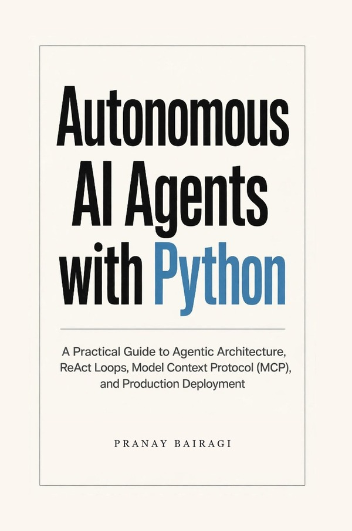

<div align="center">

# Hi there, I'm Pranay Bairagi 👋

### **AI Systems Architect & Published Author**
*Building deterministic, production-grade autonomous agent systems, ReAct loops & Model Context Protocol (MCP) integrations.*

<br/>

[-FF9900?style=for-the-badge&logo=amazon&logoColor=white)](https://www.amazon.com/dp/B0HS6F1HW6)
[-232F3E?style=for-the-badge&logo=amazon&logoColor=white)](https://www.amazon.com/dp/B0HSQ4C3HX)
[](https://github.com/Pranaybairagi/autonomous-ai-agents)

<br/>

---

</div>

## 📖 Published Book: *Autonomous AI Agents with Python*

<table border="0">
  <tr>
    <td width="30%" align="center" valign="top">
      <a href="https://www.amazon.com/dp/B0HS6F1HW6">
        
      </a>
      <br/><br/>
      <a href="https://www.amazon.com/dp/B0HS6F1HW6"><strong>Available Globally on Amazon</strong></a>
    </td>
    <td width="70%" valign="top">
      <p>
        A practical, code-heavy engineering guide to building resilient, framework-agnostic AI agent systems in native Python 3.11+. Every architectural pattern in the book is engineered to survive real-world production constraints.
      </p>
      <ul>
        <li><strong>Native ReAct Loop:</strong> First-principles Thought-Action-Observation state machines without black-box framework lock-in.</li>
        <li><strong>Compiler-Grade Validation:</strong> Self-healing type boundaries and structured schemas using Pydantic V2.</li>
        <li><strong>Execution Sandboxing:</strong> Path jails, subprocess timeouts, and command blacklists safeguarding host infrastructure.</li>
        <li><strong>Model Context Protocol (MCP):</strong> Universal open standard for standardized database and API tool orchestration.</li>
        <li><strong>Multi-Agent Coordination:</strong> Hierarchical coordinator-worker swarms collaborating via typed shared memory blackboards.</li>
        <li><strong>Production FastAPI & Docker:</strong> Asynchronous agent runtimes with real-time SSE streaming.</li>
      </ul>
      <p>
        👉 <strong><a href="https://github.com/Pranaybairagi/autonomous-ai-agents">Browse Official Source Code on GitHub →</a></strong>
      </p>
    </td>
  </tr>
</table>

---

## 🛠️ Core Engineering Stack

```
AI & Systems      :: Model Context Protocol (MCP) • ReAct Loops • Multi-Agent Swarms • Pydantic V2
Languages         :: Python (3.11 / 3.12) • TypeScript • Dart / C++
Backend & Runtime :: FastAPI (Async / SSE) • Docker & Compose • Redis • SQLite • PostgreSQL
Architecture      :: State Machines • OS Subprocess Sandboxing • Deterministic Guardrails
```

---

## 🏛️ The 4 Invariant Laws of Production Agents

1. **An Uncapped Loop is an Uncapped Credit Card** — Hard step limits, timeout budgets, and token circuit breakers.
2. **LLMs Hallucinate Types; Compilers Do Not** — Strict schema contracts with automated reflection repair loops.
3. **System Prompts are Suggestions; Sandboxes are Laws** — Process isolation, path jails, and command blacklists.
4. **Shared State Blackboard Over Chatty Swarms** — Centralized typed state graphs over unconstrained conversational agents.

---

## 📊 GitHub Analytics

<div align="center">
  
  
</div>

<br/>

<div align="center">
  <sub>Authored by <strong>Pranay Bairagi</strong> • Connecting probabilistic intelligence with deterministic software.</sub>
</div>
